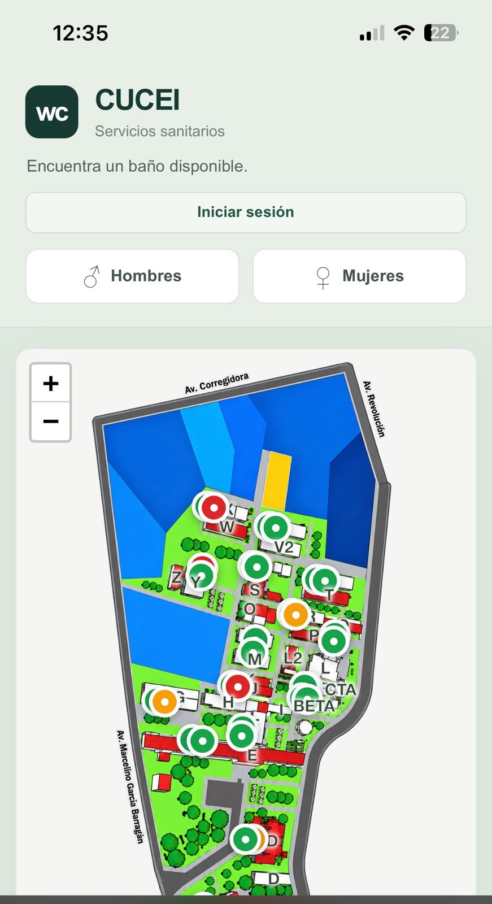
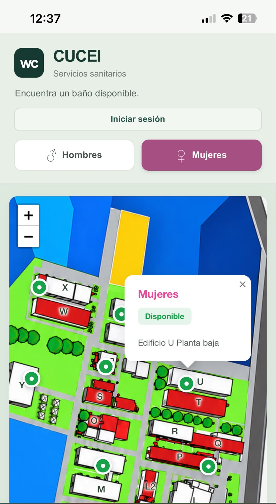
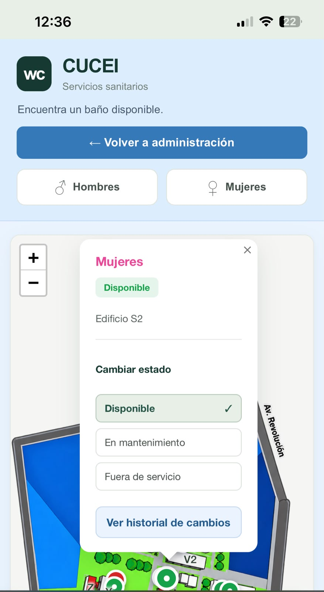
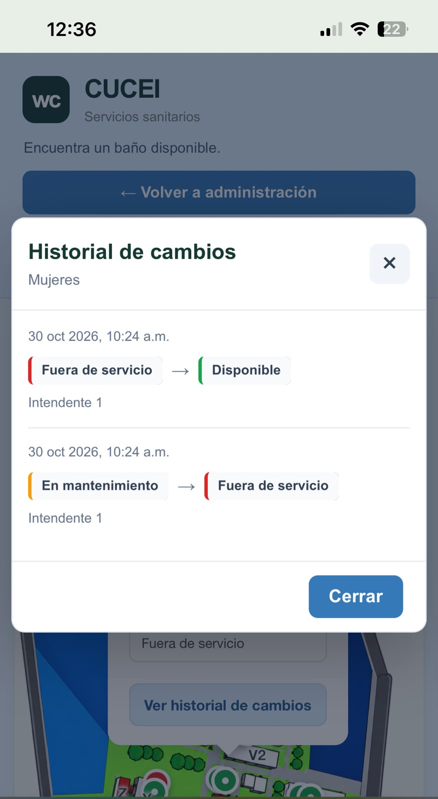
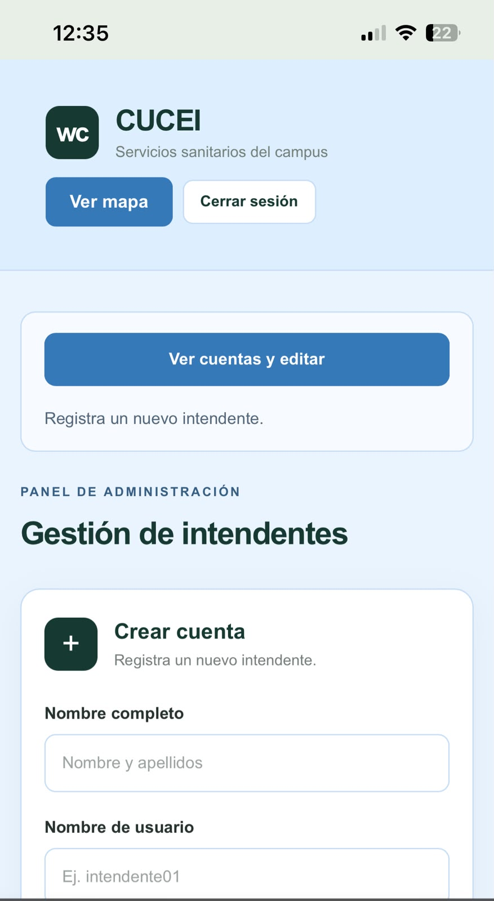
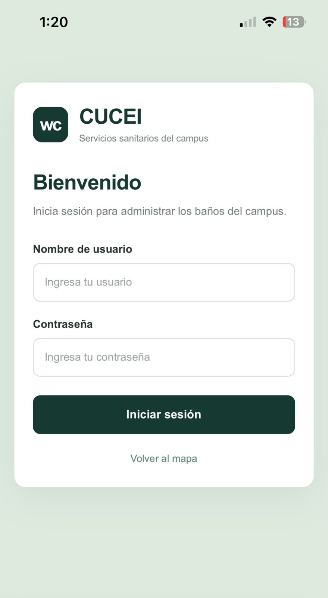

# wc CUCEI

## Project Overview

wc CUCEI is a web application designed to help students find available restrooms across the CUCEI campus through an interactive map.

The application addresses a common problem: students sometimes arrive at a restroom only to find it closed, under maintenance, or out of service. By providing up-to-date restroom availability information, the application helps students identify available facilities before visiting them.

Maintenance staff can update restroom statuses, while administrators can manage maintenance staff accounts.

## Features

### Students

- View all restrooms on an interactive campus map.
- Check the current status of each restroom.
- Filter restrooms by gender (men's and women's restrooms).
- Identify available restrooms without requiring an account.

### Maintenance Staff

- Access a dedicated management interface.
- View all restrooms on the campus map.
- Update restroom statuses:
  - Available
  - Maintenance
  - Out of Service
- View the status change history of each restroom.

### Administrator

- Access all maintenance staff features.
- Access the administration panel.
- Perform full CRUD operations on maintenance staff accounts:
  - Create accounts.
  - View account information.
  - Update account information.
  - Delete accounts.

## Technology Stack

### Frontend

- **React** — JavaScript library for building the user interface.
- **Vite** — Frontend development and build tool.
- **Leaflet** — Interactive maps and restroom locations.
- **Docker** — Containerization of the frontend application.

### Backend

- **Flask** — Python web framework for the API.
- **Docker** — Containerization of the backend application.
- **Amazon EC2** — Cloud infrastructure hosting the application.

### Database

- **PostgreSQL** — Relational database for storing restroom information, availability statuses, and staff account data.
- **Docker** — Containerization of the database.

## Architecture

wc CUCEI follows a client-server architecture composed of three main components: frontend, backend, and database.

All three components are containerized using Docker and deployed on a single Amazon EC2 instance.

### Frontend

Built with React, Vite, and Leaflet, the frontend provides the interactive campus map and the interfaces used by maintenance staff and administrators.

The frontend runs inside a Docker container and communicates with the backend through its REST API.

### Backend

The backend is built with Flask and runs inside a Docker container on the Amazon EC2 instance.

It provides the REST API responsible for retrieving restroom information, updating restroom statuses, handling authentication, and managing maintenance staff accounts.

### Database

PostgreSQL runs inside its own Docker container on the same Amazon EC2 instance.

It stores restroom locations, availability statuses, and maintenance staff account information.

### Deployment

Docker Compose is used to orchestrate the deployment of the frontend, backend, and database services. Each component runs in its own Docker container, and all containers are deployed on a single Amazon EC2 instance.

The `docker-compose.yml` file defines and manages the three services:

- **Database (`db`):** PostgreSQL 17, with persistent storage through Docker volumes and a health check to ensure database readiness.
- **Backend (`backend`):** Flask API, built from its Dockerfile and configured to connect to the PostgreSQL service through Docker's internal network.
- **Frontend (`frontend`):** React application served by Nginx, built from its Dockerfile and exposed through port 80.

Docker Compose also manages service dependencies, ensuring that the backend starts only after the database passes its health check.

The frontend communicates with the Flask API, which handles application logic and interacts with the PostgreSQL database.

## Screenshots

### Student View

### Gender Filter

### Maintenance Staff

### Restroom Status History

### Administrator Dashboard

### Login

